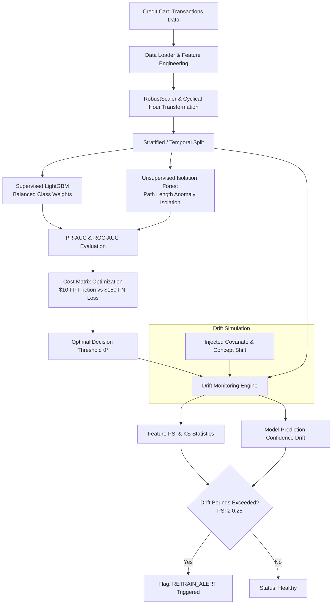

# Fraud Detection and Model Drift Monitoring Pipeline

A robust end-to-end anomaly detection and drift monitoring system designed for fintech payment streams. This project handles severe class imbalance (0.17% fraud prevalence), benchmarks supervised and unsupervised algorithms, performs financial cost-benefit threshold optimization, and implements continuous distribution drift surveillance using Population Stability Index (PSI) and Kolmogorov-Smirnov (KS) tests.

---

## Table of Contents
- [Project Overview](#project-overview)
- [System Architecture](#system-architecture)
- [Repository Structure](#repository-structure)
- [Installation and Setup](#installation-and-setup)
- [Pipeline Execution](#pipeline-execution)
- [Methodology and Key Decisions](#methodology-and-key-decisions)
  - [Imbalance Handling](#1-imbalance-handling-5771-ratio)
  - [Model Benchmarking: LightGBM vs. Isolation Forest](#2-model-benchmarking-supervised-vs-unsupervised)
  - [Evaluation Metrics: PR-AUC vs. ROC-AUC](#3-evaluation-metrics-pr-auc-vs-roc-auc)
  - [Business Cost Matrix Optimization](#4-business-cost-matrix-optimization)
  - [Drift Detection & Retraining Trigger Engine](#5-drift-detection--retraining-trigger-engine)
  - [Bonus: Artificial Drift Injection Simulation](#6-artificial-drift-simulation-bonus)
- [Empirical Benchmark Results](#empirical-benchmark-results)

---

## Project Overview

In transactional financial platforms, static machine learning classifiers quickly suffer from performance decay due to:
- **Covariate Shift:** Shifts in overall spending distributions, seasonal purchasing surges, and ticket sizes.
- **Concept Shift:** Evolution of adversarial fraud techniques designed to circumvent existing decision rules.

This repository implements a production-style pipeline that flags anomalous transactions and continuously monitors incoming data streams for statistical divergence, automatically issuing alerts when distribution shifts warrant retraining.

---

## System Architecture



---

## Repository Structure

```
.
├── data/
│   └── creditcard.csv                 # Raw dataset (downloaded via script)
├── notebooks/
│   └── fraud_detection_drift_monitoring.ipynb # Walkthrough experiment notebook
├── results/
│   ├── figures/                       # Saved evaluation and monitoring figures
│   │   ├── model_comparison_pr_roc.png
│   │   ├── threshold_cost_optimization.png
│   │   └── temporal_drift_psi.png
│   └── metrics_summary.json           # Exported metrics summary
├── src/
│   ├── __init__.py
│   ├── data_loader.py                 # Ingestion, scaling, and windowing
│   ├── models.py                      # Model implementations and scoring
│   ├── evaluation.py                  # PR-AUC, ROC-AUC, and cost optimization
│   ├── drift_monitor.py               # PSI and KS-test monitoring watchdog
│   └── drift_simulation.py            # Synthetic drift injection experiment
├── download_data.py                   # Dataset download utility with resume support
├── run_pipeline.py                    # End-to-end command line execution script
├── requirements.txt                   # Project dependencies
└── README.md                          # Technical documentation
```

---

## Installation and Setup

### 1. Clone the Repository
```bash
git clone https://github.com/your-username/fraud-detection-drift-monitoring.git
cd fraud-detection-drift-monitoring
```

### 2. Set Up Virtual Environment
```bash
python -m venv venv
# Windows:
venv\Scripts\activate
# Linux/macOS:
source venv/bin/activate
```

### 3. Install Dependencies
```bash
pip install -r requirements.txt
```

### 4. Download Dataset
The dataset contains 284,807 anonymized European credit card transactions from Kaggle/ULB. Run the download utility:
```bash
python download_data.py
```
This downloads and verifies `creditcard.csv` directly into the `data/` directory.

---

## Pipeline Execution

To run the complete pipeline (data preprocessing, dual-model training, PR-AUC evaluation, cost optimization, temporal drift detection, and the bonus simulation):

```bash
python run_pipeline.py
```

All figures and evaluation metrics are written to `results/figures/` and `results/metrics_summary.json`.

To run the interactive notebook:
```bash
jupyter notebook notebooks/fraud_detection_drift_monitoring.ipynb
```

---

## Methodology and Key Decisions

### 1. Imbalance Handling (577:1 Ratio)
The dataset comprises **284,315 legitimate** transactions ($99.83\%$) and only **492 fraud** transactions ($0.17\%$).

- **Why Not Naive Oversampling:** Duplicating rare positive samples creates tight decision boundaries around duplicate points in feature space, leading to tree overfitting and poorly calibrated probabilities.
- **Why Not SMOTE in High Dimensions:** Linear interpolation between nearest neighbors in 28-dimensional PCA space can generate synthetic minority samples inside dense legitimate regions, introducing synthetic noise.
- **Chosen Approach - Balanced Class Weighting:** We apply cost-sensitive class weights in LightGBM (`class_weight='balanced'`), adjusting loss gradients proportionally to class rarity ($w_j = N / (2 \cdot N_j)$). This forces splits to penalize minority misclassification without corrupting original feature topology.
- **Feature Scaling:** Transaction `Amount` exhibits extreme skewness ($0.00$ to $25,691.16$). We apply `RobustScaler` (median and Interquartile Range) rather than standard z-score scaling to avoid outlier distortion. `Time` is transformed into a cyclical `hour_of_day` ($0-23$) representation.

---

### 2. Model Benchmarking: Supervised vs. Unsupervised

Two complementary paradigms are evaluated:
- **Supervised: LightGBM Classifier:** Gradient-boosted decision trees trained with balanced sample weights to maximize discriminative power on known fraud signals.
- **Unsupervised: Isolation Forest:** An ensemble of random space-partitioning trees (iTrees) trained with zero label access. Observations isolated with shorter average path lengths are scored as anomalies, providing an unsupervised safeguard for novel fraud patterns.

---

### 3. Evaluation Metrics: PR-AUC vs. ROC-AUC

- **ROC-AUC Fallacy:** The False Positive Rate is defined as $\text{FPR} = \frac{\text{FP}}{\text{FP} + \text{TN}}$. With over $71,000$ True Negatives in the validation window, hundreds of false alarms produce an FPR well below $0.01$. This keeps the ROC curve pinned against the top-left axis, resulting in an artificially inflated ROC-AUC ($0.97+$).
- **Precision-Recall AUC:** Precision ($\frac{\text{TP}}{\text{TP} + \text{FP}}$) has no True Negatives in its denominator. Every false alarm immediately penalizes precision. PR-AUC (Average Precision) reflects operational performance on extreme imbalance.

---

### 4. Business Cost Matrix Optimization

Default binary classifiers predict positive at probability $\theta \ge 0.50$. However, errors carry asymmetric business costs:

$$\text{Total Loss}(\theta) = \big(\text{FP}(\theta) \cdot C_{\text{FP}}\big) + \big(\text{FN}(\theta) \cdot C_{\text{FN}}\big)$$

- **Cost of False Positive ($C_{\text{FP}} = \$10$):** Customer friction, verification SMS/call costs, card block overhead.
- **Cost of False Negative ($C_{\text{FN}} = \$150$):** Direct fraudulent chargeback loss, investigation expenses, merchant dispute fees.

Evaluating a threshold grid $\theta \in [0.01, 0.99]$ identified an optimal operating point at **$\theta^* = 0.66$**, which reduces total business losses by **$12.2\%$** compared to the $0.50$ baseline, decreasing false positives from $73$ down to $31$ without increasing false negatives.

---

### 5. Drift Detection & Retraining Trigger Engine

The monitoring module monitors data stability across temporal production windows:
1. **Population Stability Index (PSI):**
   $$\text{PSI} = \sum_{i=1}^B (Q_i - P_i) \cdot \ln\left(\frac{Q_i}{P_i}\right)$$
   - $\text{PSI} < 0.10$: Stable
   - $0.10 \le \text{PSI} < 0.25$: Moderate Shift (Warning)
   - $\text{PSI} \ge 0.25$: Critical Drift (Retraining Action Required)
2. **Two-Sample Kolmogorov-Smirnov (KS) Test:** Measures maximum cumulative distribution divergence $D = \sup_x |F_{\text{ref}}(x) - F_{\text{prod}}(x)|$ with significance testing at $\alpha = 0.01$.
3. **Prediction Probability Drift:** Tracks shifts in the model's output confidence scores.

**Alert Logic:** The system issues a `RETRAIN_ALERT` if prediction confidence PSI exceeds $0.25$, or if more than $15\%$ of features breach critical thresholds.

---

### 6. Artificial Drift Simulation (Bonus)

To validate the monitoring engine under synthetic production anomalies, the script simulates:
- **Covariate Shift:** Sudden $2.5\times$ transaction amount scaling (seasonal holiday surge).
- **Concept Shift:** Distribution perturbation across key fraud-predictive features ($V14, V12, V10$).

In testing, the clean stream maintained stable operations, while the drifted stream triggered a critical PSI spike ($0.843$ on model confidence), verifying that the monitoring watchdog flags anomalies and initiates the retraining trigger.

---

## Empirical Benchmark Results

### Model Performance Comparison

| Metric | Supervised LightGBM | Unsupervised Isolation Forest |
| :--- | :---: | :---: |
| **PR-AUC (Primary Metric)** | **0.8496** | **0.2355** |
| **ROC-AUC (Inflated by TNs)** | **0.9744** | **0.9454** |
| **Recall @ Default 0.50** | **85.4%** | **29.3%** |
| **Precision @ Default 0.50** | **59.0%** | **31.3%** |
| **F1-Score @ Default 0.50** | **0.6977** | **0.3026** |
| **False Positives (FP)** | 73 | 77 |
| **False Negatives (FN)** | 18 | 87 |
| **Label Supervision** | Supervised | **Zero Labels (Unsupervised)** |

### Cost Matrix Optimization ($C_{\text{FP}} = \$10$, $C_{\text{FN}} = \$150$)

| Scenario | Threshold ($\theta$) | False Positives | False Negatives | Total Financial Loss | Cost Reduction |
| :--- | :---: | :---: | :---: | :---: | :---: |
| **Default Baseline** | $0.50$ | 73 | 18 | $\$3,430.00$ | Baseline |
| **Cost-Optimized** | **$0.66$** | **31** | **18** | **$\$3,010.00$** | **-12.2% ($\$420$ saved)** |

---

## License
MIT License. Dataset provided courtesy of the Machine Learning Group at ULB.
